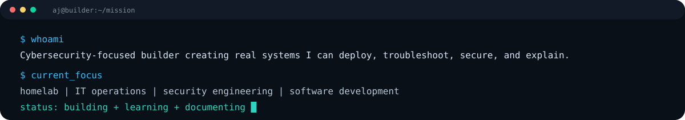

<p align="center">
  
</p>

<p align="center">
  <strong>Cybersecurity • IT Infrastructure • Software Engineering</strong><br/>
  Building real systems I can deploy, troubleshoot, secure, verify, and explain.
</p>

<p align="center">
  
  
  
</p>

---

## 01 // WHO I AM

I’m a cybersecurity-focused builder developing practical experience across IT support, infrastructure, networking, systems administration, application security, and software engineering.

My approach is simple: **build something real, verify that it works, document the evidence, understand why it works, and improve it.**

<p align="center">
  
</p>

---

## 02 // FEATURED BUILDS

### 🛡️ Enterprise Cybersecurity Homelab
A hands-on environment for learning and demonstrating real infrastructure, security, and troubleshooting workflows.

**Current areas of work**
- Windows and Linux administration
- VirtualBox networking and segmented lab environments
- Active Directory and identity management
- SSH, DNS, SMB, RBAC, and permissions
- Connectivity troubleshooting from endpoint to infrastructure
- Security validation and evidence collection
- Repeatable IT support procedures and interview-ready technical explanations

> Goal: turn theoretical knowledge into systems I can **operate, troubleshoot, secure, and explain under pressure**.

### ⚙️ AtlasIQ
A production-minded software project used to strengthen engineering, architecture, security, and product-development skills.

**Areas represented in the build**
- Next.js / React / TypeScript
- Authentication and authorization
- Supabase-backed application architecture
- Portfolio and financial-data workflows
- UI/UX systems
- Application security review
- Testing, debugging, documentation, and deployment workflows
- AI-assisted engineering with explicit verification and review

> Goal: build software with the discipline expected in a real engineering environment—not just make something that runs.

---

## 03 // TECHNICAL STACK

### Systems & Infrastructure
<p>
  
  
  
  
  
  
</p>

### Software
<p>
  
  
  
  
  
  
  
  
</p>

### Security & Workflow
<p>
  
  
  
  
  
</p>

---

## 04 // CURRENT DEVELOPMENT

| Track | Status | What I'm strengthening |
|---|---|---|
| 🛡️ Cybersecurity Homelab | **Active** | Infrastructure, networking, IAM, troubleshooting, security evidence |
| 🎓 CompTIA Security+ | **In Progress** | Core security concepts, controls, threats, operations |
| ⚙️ AtlasIQ | **Active Development** | Software engineering, architecture, auth, security, testing |
| 🧠 Technical Interview Readiness | **Active** | Clear, repeatable explanations for real IT and cyber scenarios |

---

## 05 // HOW I WORK

```text
DEFINE   → What problem are we solving?
INSPECT  → What evidence and context already exist?
DECIDE   → What is the smallest high-value action?
EXECUTE  → Build or fix the thing.
VERIFY   → Test it. Prove it.
LEARN    → Understand why it worked.
DOCUMENT → Preserve the evidence and lesson.
STOP     → Don't create unnecessary complexity.
```

I care about **repeatability, evidence, technical understanding, and clean documentation** as much as the final output.

---

## 06 // GITHUB SIGNAL

<p align="center">
  
  
</p>

<p align="center">
  
</p>

---

## 07 // CURRENT MISSION

> Build hands-on expertise across cybersecurity, IT operations, infrastructure, and software engineering through systems I can actually **deploy, troubleshoot, secure, verify, document, and explain**.

<p align="center">
  <sub>Always building. Always verifying. Always learning.</sub>
</p>
