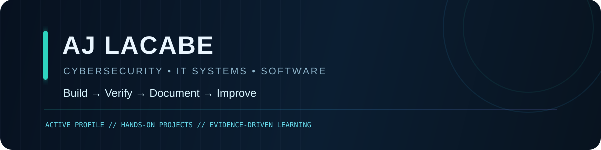

<p align="center">
  
</p>

# Systems Engineering · Identity Security · Applied Software

I design, implement and independently verify real workflows: identity and access, secure applications, operational automation, analytics, and media production. My work emphasizes repeatability, measurable outcomes, source evidence, and explicit release gates.

> **Release policy:** a working demo is not a production system. Each listing distinguishes implemented behavior from testing, pilot and commercial acceptance.

## Flagship roadmap — unified customer operations

### LeadFlow CX (working title) · Project 6 + Project 8
**Status: integration in review — NOT customer-production ready.**

One proposed business service for inbound lead intake, grounded support responses, explainable qualification, human inbox, and consent-aware follow-up drafts.

- **Canonical application:** [Project 8 — AI Customer Support](https://github.com/ajlacabe23-2426/Project-8-AI-customer-support) (Next.js + Supabase tenant model).
- **Source business rules:** [Project 6 — LeadFlow](https://github.com/ajlacabe23-2426/project6-leadflow-v1) (deterministic scoring, lifecycle controls, durable local outbox).
- **Existing integration candidates:** [PR #52 — scoring parity](https://github.com/ajlacabe23-2426/Project-8-AI-customer-support/pull/52), [PR #53 — tenant-safe persistence](https://github.com/ajlacabe23-2426/Project-8-AI-customer-support/pull/53).
- **Proposed customer measure:** lead-to-human-response time, qualified lead follow-up coverage, and inbox case-resolution time, each measured against a documented baseline.
- **Not yet established:** production tenant isolation, staffed response SLA, external delivery, real scheduling, billing, recovery drills, or independently verified customer results.

## Product pipeline

| Product | Intended customer outcome | Evidence-backed status |
| --- | --- | --- |
| [Project 5 — Document Intelligence](https://github.com/ajlacabe23-2426/Project-5-Document-Intelligence-) | Turn commercial documents into cited fields, contradictions and reviewer queues | Local deterministic foundation; sandboxed arbitrary-file processing and paid-customer acceptance pending |
| [Project 7 — Owner Intelligence](https://github.com/ajlacabe23-2426/project7-owner-intelligence) | Prioritize evidence-linked operating findings | Synthetic/local demo; commercial utility and source quality unverified |
| [Project 9 — Market Research Lab](https://github.com/ajlacabe23-2426/Project-9--Swing-Bot) | Reproducible completed-bar market scenario analysis | Research-only; source/corporate-action and independent out-of-sample validation pending |
| [Axiovela](https://github.com/ajlacabe23-2426/Axiovela) | Decision intelligence and portfolio research | Beta engineering; hosted acceptance, legal activation and production recovery pending |
| [SportProb — Sports Statistics Lab](https://github.com/ajlacabe23-2426/project-sportbet22) | Offline player-performance history and research methods | Synthetic/retrospective validation; not a wagering product |
| [Distribution Hub](https://github.com/ajlacabe23-2426/portfolio-distribution-hub) + [Kairo Knox](https://github.com/ajlacabe23-2426/FacelessAI-KairoKnox) | Human-approved scripted media production with reusable assets and verified publication records | Review-first production workflow; platform publication and audience outcomes require independent evidence |

## Security and engineering foundations

- [Enterprise Cybersecurity Homelab](https://github.com/ajlacabe23-2426/EnterpriseCyberSecHomeLab): Windows/Linux administration, network diagnosis, log collection, identity and access management laboratories.
- Primary technical focus: **Identity Security Engineering** — Active Directory / Entra ID, authentication, authorization, privileged access, least privilege, and auditing.
- Software toolkit: TypeScript, React, Next.js, Python/FastAPI, Postgres/Supabase, Docker, CI, and test automation.
- Controls: threat modeling, tenant-negative tests, secret scanning, rollback rehearsals, reproducible datasets, and evidence-linked release reports.

## The acceptance ladder

1. **Prototype:** a bounded workflow runs locally with synthetic or permitted data.
2. **Verified candidate:** CI, reproducible fixtures, security-negative tests, and external review pass on the exact commit.
3. **Private pilot:** approved isolated environment, recovery tested, privacy and consent controls reviewed, and a customer success metric instrumented.
4. **Production:** staffed operations, monitoring/alerting, documented incident response, contractual/privacy obligations, and independently confirmed customer value.

Progress is measured by evidence — not repository count, feature count, or generated demonstrations.

## Delivery practice

```text
CUSTOMER PROBLEM -> BASELINE -> CONTRACT -> SMALL CHANGE -> TEST
      -> SECURITY REVIEW -> PILOT -> OBSERVED OUTCOME -> RELEASE DECISION
```

**No invented results:** GitHub checks, hosted environments, revenue, customer use, and publish status are described only when verifiable.

---
<sub>Selected projects are development or research candidates. See their repositories for current restrictions and testing instructions.</sub>
